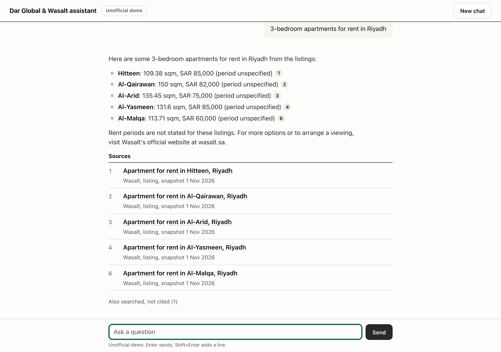

# Dar Global & Wasalt Assistant

A chatbot that answers questions about [Dar Global](https://darglobal.co.uk/) projects and [Wasalt](https://wasalt.sa/en) property listings from a snapshot of their public websites, cites the page behind every claim, and answers in English or Arabic. Unofficial; not affiliated with either company.

**Live:** https://chat-cxh7cszoia-el.a.run.app



Try: "Where is Tierra Viva?", "3-bedroom apartments for rent in Riyadh", "ما هي مشاريع دار جلوبال في عمان؟", or "Does Dar Global have projects in Japan?" (it should say no). The first request after an idle spell waits about 10 s for a cold start.

## How it works

Pages were collected once, offline, and indexed: 447 documents (233 Dar Global pages, 14 Wasalt pages, 200 Wasalt listings) in 2,171 chunks. Each question runs a hybrid keyword and vector search over that index, filters listings by any city, price, bedroom or sale/rent constraint in the question, and sends the six best passages to a free model on OpenRouter, which streams back an answer with `[n]` citations. Production never contacts either website.

| | |
|---|---|
| App | FastAPI, one static page, Server-Sent Events |
| Retrieval | BM25 + `paraphrase-multilingual-MiniLM-L12-v2` (fastembed), Reciprocal Rank Fusion, in memory |
| Model | `nvidia/nemotron-3.5-super-vl:free`, falling back to `nemotron-3.5-lightning` then `nemotron-3-ultra` |
| Hosting | Cloud Run, asia-south1, 0 to 2 instances; image built and deployed by GitHub Actions |

## Write-ups

- [Architecture](docs/ARCHITECTURE.md): request flow, and why hybrid search, small chunks and no database
- [Data collection](docs/DATA_COLLECTION.md): robots.txt, rate limits, how Cloudflare-challenged pages were handled, personal data
- [Model choice](docs/MODEL_CHOICE.md): the bake-off of free models and the fallback chain
- [Security](docs/SECURITY.md): threats, controls and the gaps left open
- [Verification](docs/VERIFICATION.md): how the AI-written code was checked (tests, retrieval eval, LLM judge, red team)

## Run locally

Needs Python 3.12, [uv](https://docs.astral.sh/uv/), and an [OpenRouter key](https://openrouter.ai/keys).

```bash
uv sync
cp .env.example .env              # set OPENROUTER_API_KEY
make test                         # 94 tests, no network
```

The corpus is not in this repository: it is third-party content, and it lives in a private bucket. To run the app you need an index, either pulled from the bucket (with access) or rebuilt from the sites:

```bash
# with access to the bucket
mkdir -p index && gcloud storage cp "gs://dar-wasalt-chat-22ytj-corpus/index/fc1e965542bd/*" index/

# or from scratch
uv run playwright install chromium
make crawl                        # Dar Global; Wasalt pages are saved by hand, see docs/DATA_COLLECTION.md
make extract                      # raw HTML to data/docs.jsonl
make index                        # data/docs.jsonl to index/
```

Then:

```bash
make run                          # http://localhost:8000
make eval                         # retrieval gate: hit@5 must stay at or above 0.85
```

With Docker (the image bakes in `./index` and the embedding model):

```bash
make docker-run                   # http://localhost:8080
```

### Configuration

Set in `.env` locally, or as Cloud Run variables. Only the key is required.

| Variable | Default | |
|---|---|---|
| `OPENROUTER_API_KEY` | none | Secret Manager in production |
| `OPENROUTER_MODELS` | the chain above | comma-separated, primary first |
| `ACCESS_PASSCODE` | unset | if set (20+ characters), `/api/chat` needs header `X-Access-Code` |
| `RATE_PER_MINUTE`, `RATE_PER_DAY` | 10, 100 | per client, per instance |
| `GLOBAL_PER_MINUTE`, `GLOBAL_PER_DAY` | 60, 1000 | whole service, per instance |
| `TRUSTED_PROXY_HOPS` | 1 | proxies in front of the app; 1 on Cloud Run |
| `LOG_SALT` | random per process | salt for the client-IP hash in logs |

## Deploy

Deploys are automatic: every push to `main` runs lint, the tests, a gitleaks scan of the full history and the retrieval gate, then builds the image, pushes it to Artifact Registry, deploys it to Cloud Run and smoke-tests `/health` and one chat (`.github/workflows/ci.yml`). GitHub authenticates to GCP with Workload Identity Federation, so no service-account keys exist.

To set it up in a new GCP project:

1. Create the project and enable the Cloud Run, Artifact Registry, Secret Manager, IAM, IAM Credentials and STS APIs.
2. Create a Docker repository `app` in Artifact Registry, a private bucket `<project>-corpus`, and a secret `openrouter-api-key` holding the key.
3. Build the index and upload it: `uv run python -m ingest.build_index --upload gs://<project>-corpus/index`. The upload goes to a folder named after the first 12 characters of the corpus hash.
4. Run `PROJECT=<project> REPO=<owner>/<repo> ./infra/setup-gcp.sh`. It creates the runtime, CI and deploy service accounts and the GitHub identity pool, and prints the provider name.
5. In `ci.yml`, set `PROJECT`, `INDEX` (the bucket folder from step 3) and `WIF_PROVIDER` (from step 4), then push to `main`.

New IAM bindings can take a few minutes to apply; if the first run fails with a 403 on `getAccessToken`, re-run it.

## Limitations

- **Snapshot, not live.** Dar Global pages are from 2026-10-31 and Wasalt pages from 2026-11-01. Prices and availability change; every answer shows its snapshot date.
- **A sample of listings.** 200 Wasalt listings across ten categories, not the full catalogue. Six Wasalt legal pages and four Dar Global pages are missing (`DATA_COLLECTION.md`).
- **Free models.** They can be slow, rate-limited or withdrawn without notice, and all three in the chain are NVIDIA endpoints, so one provider outage takes out every fallback. A slow model hits the 50 s deadline instead of falling back.
- **Per-instance limits.** Rate limits are held in memory, so two instances allow up to twice the stated limits.
- **English corpus.** Arabic questions are answered in Arabic from English text; names are sometimes left in English or misspelled.
